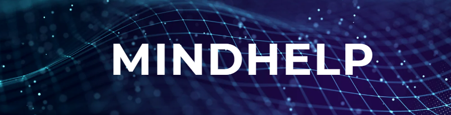
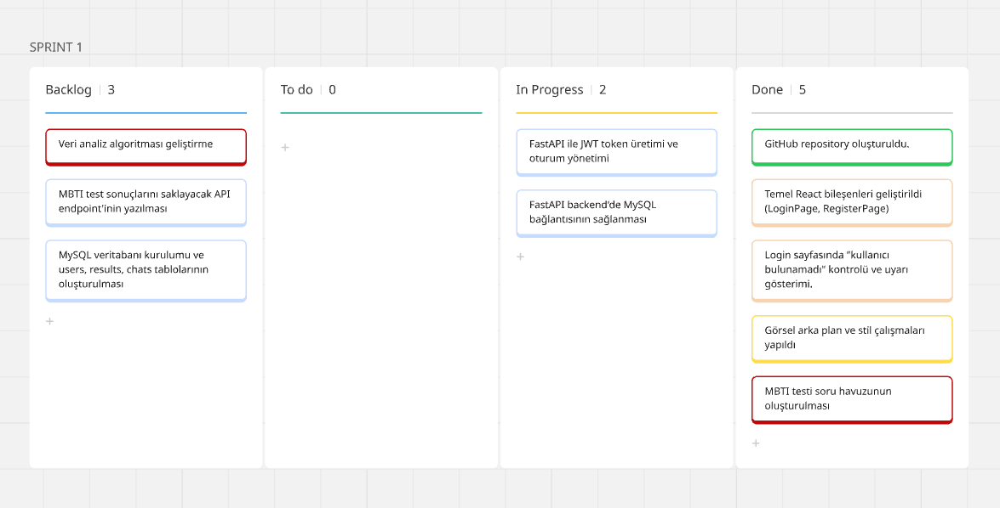
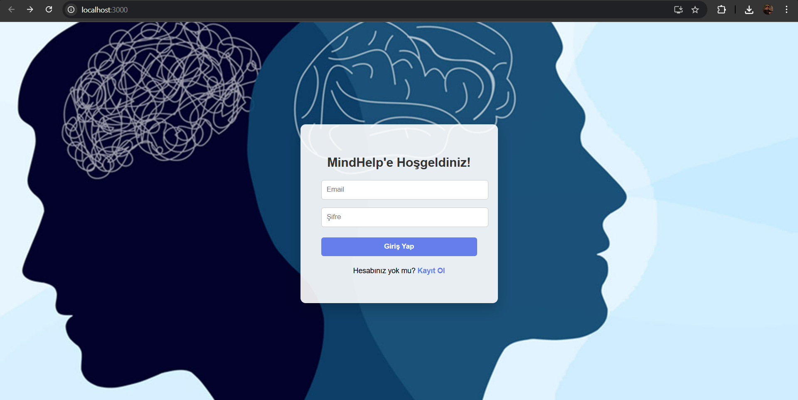
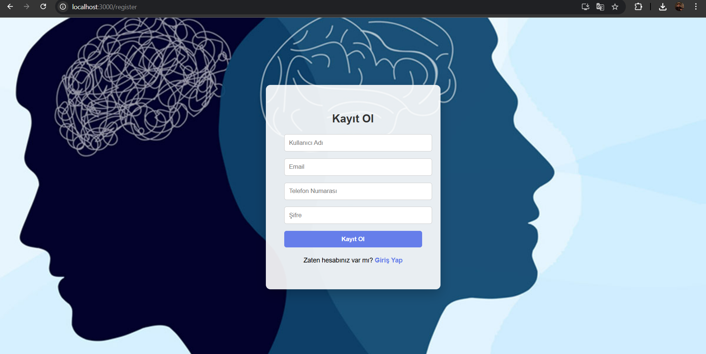
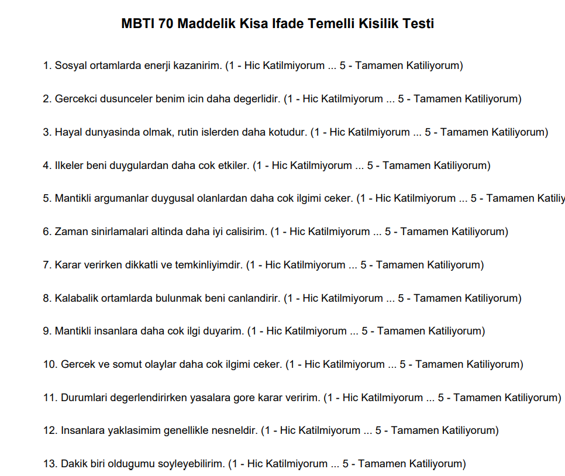
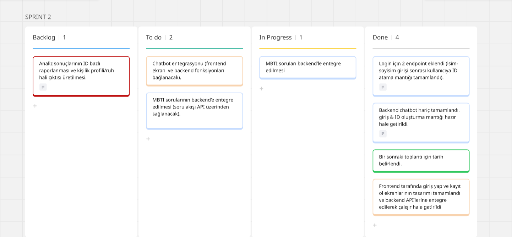

# Takım İsmi

Takım 119 Yapay Zeka

# Takım Üyeleri

| İsim                   | Rol             | Sosyal Medya |
|------------------------|------------------|----------|
| Fatma Didenur Özgüven | Product Owner    |  |
| Efehan Hüsrevoğlu      | Scrum Master     |  |
| Ahmet Efe Akçay        | Developer        |  |
| Yusuf Koğa             | Developer        |  |

# Ürün İsmi

MindHelp

# Ürün Açıklaması

MindHelp, kullanıcıların kendilerini daha yakından tanımalarını sağlamak amacıyla geliştirilen, MBTI (Myers-Briggs Type Indicator) temelli bir kişilik testi uygulamasıdır. Kullanıcı dostu arayüzüyle öne çıkan bu platformda, bireyler e-posta ve şifre ile hızlıca kayıt olabilir, giriş yaparak testi tamamlayabilir ve kişilik tiplerini detaylı analizlerle öğrenebilirler. MindHelp, kişisel farkındalığı artırmak, güçlü yönleri keşfetmek ve potansiyeli daha iyi değerlendirmek isteyen herkes için modern ve güvenli bir çözümdür. Eğitimden kariyer planlamasına kadar birçok alanda içgörü sunan bu uygulama, bireylerin kendilerini daha iyi anlamalarına yardımcı olur.

# 🚀 Ürün Özellikleri

* ✅ MBTI Temelli Kişilik Testi
  
16 farklı kişilik tipine göre kullanıcıların analizini yaparak kapsamlı sonuçlar sunar.

* 🔐 Kayıt ve Giriş Sistemi
  
E-posta ve şifre ile güvenli kullanıcı girişi sağlar; yeni kullanıcılar kolayca hesap oluşturabilir.

* 💬 Sohbet Botu ile Etkileşim

Kullanıcının kişilik tipine göre özel yanıtlar veren yapay zekâ destekli sohbet deneyimi sağlar.

# 🎯 Hedef Kitle

* 👩‍🎓 Üniversite Öğrencileri

Kendini tanımak ve kariyer yolculuğuna daha bilinçli adımlar atmak isteyen genç bireyler.

* 🧑‍💼 İK Uzmanları ve Kariyer Danışmanları

Kişilik profillerini analiz ederek daha uygun pozisyon eşleştirmeleri yapmak isteyen profesyoneller.

* 🧠 Psikoloji Meraklıları

MBTI gibi kişilik testleriyle ilgilenen, psikolojik gelişime önem veren kullanıcılar.

* 🧑‍🤝‍🧑 Bireysel Gelişimle İlgilenen Kişiler

Kendini daha iyi tanımak ve sosyal ilişkilerini geliştirmek isteyen bireyler.

* 🏫 Eğitim Kurumları ve Rehberlik Servisleri

Öğrencilerinin kişilik analizine dayalı rehberlik sağlamak isteyen okullar ve eğitim danışmanları.

# Product Backlog URL

[Click for Backlog (Miro)](https://miro.com/app/board/uXjVIheT0gE=/)

# SPRINT 1

* **Sprint Notları:** MindHelp projesine ait user story'ler, ilgili product backlog kartlarının içerisinde detaylı olarak yer almaktadır. Her backlog kartına tıklanarak bu user story'lerin kapsamı, amacı ve teknik ihtiyaçları okunabilmektedir.
* **Sprint içinde tamamlanması tahmin edilen puan:** 100 puan
* **Puan tamamlama mantığı:** Proje genelinde tahmini toplam iş yükü 300 puan olarak öngörülmüş ve bu yük, 3 sprinte eşit şekilde bölünmüştür. Bu sprint, temel sistem altyapısının kurulması ve ilk fonksiyonların hazırlanması odaklı olarak planlanmıştır.
*  **Backlog düzeni ve story seçimleri:** Sprint 1'de yer alan backlog görevleri, sonraki sprintlerde geliştirilecek modüllerin temelini oluşturacak şekilde sıralanmıştır. Sprint süresince iş gücünü dengelemek amacıyla puan limiti gözetilmiş ve görev dağılımı buna göre gerçekleştirilmiştir.
Miro board’unda görev kartları kategorilere göre renk kodlarıyla ayrılmıştır.Bu renk kodları görev takibini kolaylaştırmak ve ekip içi sorumlulukları netleştirmek amacıyla belirlenmiştir.
* **Daily Scrum:** Daily Scrum toplantıları, ekip üyelerinin günlük ilerlemelerini paylaşmaları ve engelleri belirtmeleri amacıyla her gün WhatsApp grubu üzerinden, gün içindeki müsaitlik durumlarına göre gerçekleştirilmiştir.
Bu esnek yapı, ekip içi iletişimi artırmış ve koordinasyonu sürdürmeye yardımcı olmuştur.
Günlük notlar ve iletişim kayıtları için "Sprint 1 Daily Scrums" kalsörünü inceleyebilirsiniz.
* **Sprint Board Update:**
  
* **Ürün Durumu Ekran Görüntüleri:**
  
 

* **Sprint Review:** Sprint 1 sonunda gerçekleştirilen ekip değerlendirmesinde, planlanan tüm görevlerin başarıyla tamamlandığı teyit edildi. GitHub repository’si oluşturularak proje ortamı hazırlandı. Temel React bileşenleri geliştirildi ve stil çalışmaları yapıldı. Login ekranına kullanıcı bulunamadığında uyarı gösterimi eklendi. Ayrıca MBTI testi için soru havuzu başarıyla oluşturuldu. İlk sprintte atılan bu temel adımların projenin ilerleyen aşamaları için sağlam bir zemin sunduğu ifade edildi.

Katılımcılar:
Fatma Didenur Özgüven, Efehan Hüsrevoğlu, Ahmet Efe Akçay, Yusuf Koğa

* **Sprint Retrospective:** Ekip üyeleri, sprint boyunca bazı iletişim kopuklukları yaşandığını ancak bu durumun genel ilerlemeyi olumsuz etkilemediğini belirtti. Görev dağılımında zaman zaman belirsizlikler olsa da, bireysel çabalarla sprint hedeflerine ulaşıldı. İkinci sprintte görevlerin daha net ayrılması ve frontend-backend ekiplerinin koordineli çalışması gerektiği vurgulandı. Günlük ilerleme takibinin WhatsApp üzerinden sürdürülmesine devam edilmesi ve haftalık kısa toplantılarla süreçlerin desteklenmesi önerildi.

# SPRINT 2

* **Sprint Notları:** MindHelp projesinin ikinci sprintinde, birinci sprintte temeli atılan altyapı üzerine ek fonksiyonlar geliştirilmiş ve kullanıcı deneyimini geliştirmeye yönelik arayüz çalışmaları yapılmıştır. Sprint kapsamındaki user story’ler, ilgili backlog kartlarında detaylandırılmıştır. Kartlara tıklanarak teknik gereksinimler ve iş akışları görüntülenebilmektedir.
*  **Backlog düzeni ve story seçimleri:** Bu sprintte, ilk sprintte tamamlanan temel login altyapısı üzerine yeni özellikler eklenmiştir. Chatbot entegrasyonu için hazırlık yapılmış, MBTI sorularının backend’e entegrasyonu başlatılmıştır. Ayrıca frontend tarafında giriş yap ve kayıt ol ekranları tamamlanıp backend API’lerine bağlanarak çalışır hale getirilmiştir. Backlog kartları yine kategorilere göre renk kodlarıyla düzenlenmiştir ve ekip içi sorumluluk dağılımı buna göre yapılmıştır.
*  **Daily Scrum:** Daily Scrum toplantıları, birinci sprintte de olduğu gibi ekip üyelerinin günlük ilerlemelerini paylaşmaları ve engelleri belirtmeleri amacıyla her gün WhatsApp grubu üzerinden, gün içindeki müsaitlik durumlarına göre gerçekleştirilmiştir. Bu esnek yapı, ekip içi iletişimi artırmış ve koordinasyonu sürdürmeye yardımcı olmuştur.
*  **Sprint Board Update:** 
   
*  **Sprint Review:** Sprint sonunda yapılan değerlendirmede;
Login için gerekli 2 endpoint’in başarıyla eklendiği ve isim-soyisim girişi sonrası kullanıcıya ID atama mantığının tamamlandığı,
Backend tarafında chatbot haricinde giriş ve ID oluşturma mantığının tam anlamıyla çalışır hale getirildiği,
Frontend’de giriş yap ve kayıt ol ekranlarının tasarlanıp backend API’leriyle entegre edildiği,
Bir sonraki toplantı için tarih belirlendiği
tespit edilmiştir.
Henüz tamamlanmayan chatbot entegrasyonu ve MBTI soru akışı API bağlantısı bir sonraki sprintte önceliklendirilmek üzere planlanmıştır.
  
Katılımcılar:
Fatma Didenur Özgüven, Efehan Hüsrevoğlu, Ahmet Efe Akçay, Yusuf Koğa

*  **Sprint Retrospective:** Bu sprintte frontend ve backend ekipleri arasında koordinasyon önceki sprinte göre daha net sağlanmıştır. Ancak chatbot entegrasyonu gibi bazı görevlerin ertelenmesi gerektiği için planlamada ufak kaymalar yaşanmıştır. İleriye dönük olarak, sprint başında görevlerin önceliklendirilmesi ve tamamlanma sürelerinin daha gerçekçi tahmin edilmesi gerektiği vurgulanmıştır. WhatsApp üzerinden günlük ilerleme paylaşımına devam edilmesi ve haftalık çevrimiçi kısa toplantıların eklenmesi kararlaştırılmıştır.

# SPRINT 3

* **Sprint Notları:** MindHelp projesinin final sprintinde, React frontend, FastAPI backend ve Node.js servisleri kullanılarak tam fonksiyonel platform geliştirilmiştir. Gemini 2.5 AI modeli entegre edilerek kişilik analizi sistemi tamamlanmıştır. Bu sprintte ürün lokalde çalışır duruma getirilmiş ve tüm ana özellikler entegre edilmiştir.
*  **Backlog düzeni ve story seçimleri:** Sprint 3'te yer alan backlog görevleri şu şekilde kategorize edilmiştir:
1. AI/Backend Entegrasyonu: Gemini 2.5 modelinin kişilik analizi için entegre edilmesi 
2. Veri Yönetimi: 77 adet MBTI sorusunun kategorilere ayrılması ve 1-6 arası puanlama sisteminin geliştirilmesi
3. Kişilik Hesaplama Algoritması: 3'ten yüksek puanların değerlendirilmesi ve 4 harfli kişilik tipinin oluşturulması
4. Chatbot Entegrasyonu: Kişilik tipine göre özelleştirilmiş chatbot etkileşiminin tamamlanması
5. Veritabanı İşlemleri: Kişilik tipi sonuçlarının veritabanında saklanması ve görselleştirilmesi
6. Test ve Optimizasyon: Lokalde tam fonksiyonel çalışma testlerinin yapılması
*  **Daily Scrum:** Daily Scrum toplantıları, ekip üyelerinin günlük ilerlemelerini paylaşmaları ve teknik engelleri çözmeleri amacıyla WhatsApp grubu üzerinden düzenli olarak gerçekleştirilmiştir. Final sprintte özellikle şu konular günlük olarak takip edilmiştir: Gemini 2.5 AI entegrasyonu sürecindeki ilerlemeler, kişilik hesaplama algoritmasının test sonuçları ve optimizasyonlar, chatbot geliştirme ve entegrasyon testlerinin durumu, veritabanı işlemleri ve performans iyileştirmeleri ile React–FastAPI–Node.js arasındaki sistem entegrasyonu testleri. Ayrıca API iletişiminde karşılaşılan JSON veri aktarım hataları hızlıca çözülmüş; frontend–backend veri uyumu, skorlama algoritmasındaki eşik değerlerinin netleştirilmesi ve kullanıcı girdilerinin doğru işlenmesi gibi detaylı teknik konular da günlük olarak takip edilmiştir. Bu esnek iletişim yapısı, ekip koordinasyonunu güçlendirmiş ve sprint hedeflerine ulaşılmasını sağlamıştır.
*  **Sprint Board Update:**
   
*  **Ürün Durumu Ekran Görüntüleri:**
 

*  **Sprint Review:** Tüm sprintlerin sonunda gerçekleştirilen final değerlendirmede, projenin temel bileşenleri başarıyla tamamlanmıştır. Gemini 2.5 AI modeli sisteme entegre edilmiş ve kişilik analizlerini hatasız şekilde gerçekleştirmektedir. MBTI temelli test sistemi kapsamında 77 soru kategorilere ayrılmış, 1–6 arası puanlama sistemi başarıyla uygulanmıştır. Bu altyapıya bağlı olarak geliştirilen kişilik hesaplama algoritması, 3’ten yüksek puanları baz alarak kullanıcıya özel 4 harfli kişilik tipi üretmektedir. Oluşturulan kişilik tipleri veritabanında saklanmakta ve kullanıcıya görsel olarak sunulmaktadır. Kullanıcının kişilik tipine göre yanıt verebilen özelleştirilmiş chatbot yapısı da başarıyla çalışmaktadır. Teknik altyapı olarak React tabanlı frontend, FastAPI ile geliştirilen backend ve Node.js servisleri sorunsuz şekilde entegre edilmiştir. Tüm sistem testleri tamamlanmış olup ürün, lokal ortamda tam fonksiyonel olarak çalışmaktadır.

Katılımcılar:
Fatma Didenur Özgüven, Efehan Hüsrevoğlu, Ahmet Efe Akçay, Yusuf Koğa

*  **Sprint Retrospective:** Final sprintte ekip daha koordineli çalışmıştır. Gemini 2.5 AI entegrasyonu ve kişilik algoritması geliştirmede bilgi paylaşımı etkin yapılmıştır. WhatsApp üzerinden günlük iletişim, AI testleri ve sistem entegrasyonunda kritik rol oynamıştır. 77 soruluk MBTI testinin kategorize edilmesi ve puanlama sisteminde görev dağılımı başarılı olmuştur. React-FastAPI-Node.js stack öğreniminde ekip birbirini desteklemiştir.
